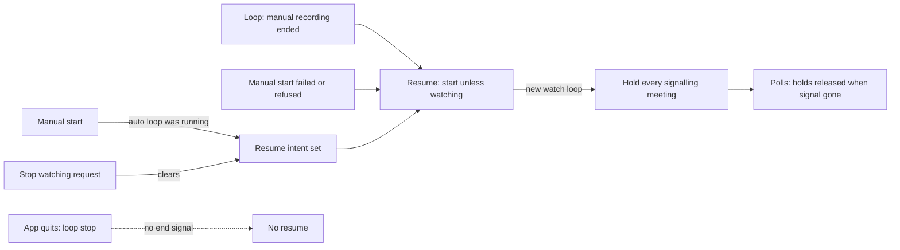

# Watching pauses during a recording and resumes after it

## Conversation Evidence

> user (turn 1, 2026-10-08): "when a recording is running it should show a stop and pause or also the continue button when it happened."
> user (turn 4, 2026-10-12): "stop watching - is it needed? Could it record several apps in parallel? Or should we just hide the stop watching while its recording? Or would we want to record two apps at the same time? Doesnt make sense in 99% of the cases, actually watching should be paused while recording isnt it?"
> user (turn 6, selected): "A — Pause rule, one small plan (Recommended)"
> user (turn 7, selected): "A — Skip every running call (Recommended)"
> user (turn 7, selected): "A — No, the stop cancels it (Recommended)"

## Goal & Context

The app records one meeting at a time. While a detected meeting records, it only checks whether that meeting has ended and looks for no other meeting; when the meeting ends it watches again on its own. So for detected meetings, watching already pauses during a recording and resumes after it. The owner wants that to be the rule for every recording, and the menu to stop offering a watch control while a recording runs. [paraphrase]

Two things break the rule today. First, a manual recording (app + microphone, or microphone only, started from the menu, the app picker or the automation API) switches watching off when it starts, and nothing switches it back on when it ends: watching stays off until someone presses Start Watching or the app is restarted with "Watch for meetings when the app starts". The next meeting is then neither detected nor recorded, without any notice. The automation API's microphone start already restores watching after a start that failed or was refused, but no successful recording and no menu or picker start does. Second, since gh-94 the menu shows the watch toggle below the first divider during every recording: during a detected meeting it reads "Stop Watching for Meetings" and ends the recording and watching together, and during a manual recording it reads "Start Watching for Meetings" and a click is silently refused. [inferred]

<!-- Source: 30% [paraphrase] / 70% [inferred] (current behaviour, checked in the code on wapp/main at 47c550ad by the plan's repo research) -->

## Architecture & Data Models

- **Who owns the resume.** "Watching was on when this manual recording took over, so turn it back on afterwards" is one pending intent held by the component that starts and stops the watch loop (the watching controller). It is set when a manual start stops an active watch loop, after any watch start already in flight has settled; it is not set when the manual start is refused because something is already recording. A stop-watching request clears it. It is consumed exactly once, at the moment the resumed watch loop is installed and started; a start that bails before that (because a manual start registered in the meantime) leaves it pending, and while another manual recording runs it stays pending for that recording's end. Nothing is persisted and there is no setting.
- **What signals the end.** The watch loop reports "this manual recording has ended" from its own manual-stop routine, which every manual ending passes through: the controller's stop (menu, app picker, automation API), the loop's own stops (the recorded app quitting, the 4-hour limit) and a recorder that fails at stop. The loop's general stop, which the app calls when it quits, never reports it, so quitting during a manual recording never starts watching. A manual start that never reached recording (permission refused, recorder failed to start) resumes from the start path itself.
- **How watching restarts.** The resume is "start unless already watching": the watch-start path with all its ownership checks (one start in flight at a time, a manual start registering meanwhile wins) but without any permission request: it calls none of the microphone, Screen Recording or Accessibility request functions, not even those the launch-time auto-watch and the automation API's `start` call, because macOS may show a dialog for a permission revoked during the session. A missing permission is then met the way a running watch loop meets it today, when a recording starts. The resume never runs inside the stop that triggered it, and not while a manual start is still registered (a failed start's own registration clears only when its start task returns): it waits until that registration has cleared, then re-reads live state. Already watching means nothing to do; a manual recording running means the intent stays pending. It never stops a watch loop. The resume has a handle the automation API waits on before answering a `/v1/record` stop of a manual recording or a failed `/v1/record` start, so that answer and a `GET /v1/watch` right after it agree.
- **Which calls are skipped after the restart.** The detector contract gains a read-only query for the meetings signalling right now: one detected meeting per watched app identity whose call signal is present, built exactly as detection builds it (the per-browser identity for browser meetings, the native-process exclusion, deny-listed identities skipped), without requiring confirmation, and without changing the detector's confirmation counters, cooldowns or once-per-session logging. The composite detector returns the union, one entry per identity. A detector that cannot enumerate returns none. A watch loop started by a resume places gh-94's re-detection hold on every meeting in that snapshot before its first detection decision; gh-94's release rule (the first watching poll that finds that meeting's signal gone) applies unchanged.
- **Menu.** The watch toggle is not rendered while any recording runs. The menu already knows when a recording runs: it is the same condition that shows "Stop Recording" under the status line (gh-94 R1, R8).



## API Contracts

- `POST /v1/watch` `stop` while a manual recording runs: the answer is unchanged (200, nothing changed now, as documented), and the resume is cancelled, so watching stays off after the recording. `start`, and a `toggle` that resolves to a start, keep answering 409 while a manual recording runs. [paraphrase]
- `POST /v1/record` `stop` (with or without `scope: "any"`) of a manual recording, and a `POST /v1/record` `start` that fails or is refused: same codes and bodies as today; the answer is sent once the resume has run, so watching is already back on when it arrives.
- `GET /v1/watch` and `GET /state`: no new fields. `watching` reads true again once watching has resumed.
- `docs/automation-api.md` (`/v1/watch`) states that watching resumes after a manual recording when it was on before the recording started, and that a `stop` sent during the recording cancels that.

## Edge Cases & Constraints

- **The app quits during a manual recording:** nothing resumes in this run; the next launch follows "Watch for meetings when the app starts" as today.
- **Start Watching pressed (or `/v1/watch` `start`) between a manual recording's end and the resume:** exactly one watch loop runs afterwards and watching is on; the resume finds watching on and does nothing.
- **A second manual recording started before the resume ran, or after the resume began but before its watch loop was installed** (watching was off for it, so it sets no intent of its own): the first recording's intent stays pending and resumes when the second recording ends.
- **A failed or refused manual start** resumes watching like any other end, from the menu and the app picker as well as from the automation API. One mechanism covers all of them; the automation API's existing restore after a failed microphone start is replaced by it.
- **The recorder fails at stop:** the failure is reported as today, and watching still resumes.
- **No permission prompt at resume:** resuming calls no permission-request function, so it raises no system dialog even for a permission revoked during the session; a missing permission surfaces when a recording would start, as for any running watch loop. If watching cannot start, it stays off, a diagnostic line says so (R7), and the recording's own processing is unaffected.
- **Resumed watching starts fresh:** current settings (apps to watch, ask-first and never-for-this-app rules) apply, as after a Start Watching press; in-memory state of the watch loop the manual recording replaced (an open consent prompt, cooldowns) is not carried over.
- **Snapshot timing:** a call that starts signalling after the snapshot is detected normally; a call that stopped signalling before it is not held; a call signalling at the snapshot but not yet confirmed is held. A signal absent for one poll releases the hold, as in gh-94.
- **Microphone-watching detector with no watched apps:** it signals nothing and holds nothing.
- **gh-46 (pause, planned):** pausing does not end a recording, so it never resumes watching; only the recording's end does.
- **Record-only mode:** unaffected; the resume works the same.
- **Watching off when the manual recording started:** it stays off; with the toggle hidden during the recording, someone who wants watching on afterwards presses Start Watching once the recording has ended. [paraphrase]
- `WatchingController` and `WatchLoop` main files sit just under SwiftLint's 600-line limit (lint runs `--strict`): new logic goes into extension files, the main files get only the stored state and hook lines that cannot live elsewhere.

## Acceptance Criteria

- **R1:** While any recording runs (a detected meeting, an app recording started from the menu or app picker, a microphone-only recording), the menu bar menu shows neither "Start Watching for Meetings" nor "Stop Watching for Meetings". When no recording runs, the watch toggle is shown directly under the status line exactly as today. Errors: none; in the moment between registering a manual start and its recording running, the menu shows what it shows today. [paraphrase]
- **R2:** If meeting watching was on when a manual recording started (app + microphone or microphone only; from the menu, the app picker or `POST /v1/record`), watching is on again once that recording has ended, whichever way it ended: Stop Recording in the menu, a `/v1/record` stop, the recorded app quitting, the 4-hour limit, a start that failed or was refused, or a recorder that failed at stop. If watching was off when the recording started, it stays off. Errors: resuming raises no system permission prompt; it never stops or duplicates a watch loop someone started in the meantime; quitting the app during a manual recording starts no watching; if watching cannot start, it stays off and R7's line says so, and the recording's own processing (job or record-only files) is unaffected. [paraphrase]
- **R3:** When watching resumes after a manual recording, every meeting the detectors report signalling at that moment, confirmed or not, is neither recorded nor asked about ("Record … meeting?") until a watching poll has found that meeting's signal gone once; a meeting that starts after the resume is detected, asked about and recorded as usual, and the same app's next call after its signal has gone is recorded as usual. Taking the snapshot changes nothing in detection (confirmation counts, cooldowns). Errors: none beyond the detector's own; a detector that cannot list signalling meetings holds nothing. [paraphrase]
- **R4:** A `POST /v1/watch` `stop` sent while a manual recording runs cancels the resume: after that recording ends, watching stays off. The answer is unchanged (200, as documented); `start` during a manual recording keeps answering 409. Errors: a `stop` after the recording has ended stops watching as today. [paraphrase]
- **R5:** `GET /v1/watch` reports `watching: true` once watching has resumed, with no new fields. A `/v1/record` stop of a manual recording and a failed `/v1/record` start answer only after the resume has run, with their documented codes. `docs/automation-api.md` states that watching resumes after a manual recording when it was on before, and that a `stop` sent during the recording cancels the resume. Errors: none beyond the documented codes.
- **R6:** Nothing else changes: a detected meeting's recording pauses and resumes watching as today, "Stop Recording" on a detected meeting keeps watching on (gh-94), `/v1/record` keeps its documented verbs and codes, and the watch toggle outside recordings behaves as today. Errors: none.
- **R7:** A resume writes one line to the app's diagnostic log naming how many meetings it held (no app names, titles or participants; gh-94's `redetect_hold_set app=<app>` lines name the held apps as today); a resume cancelled by a stop-watching request and a resume that could not start watching each write one line too. Errors: none beyond the log write itself.

## Early proof point

Task gh-105-watching-pauses-during-a-recording-and.1 validates the core approach (a read-only snapshot of every signalling meeting can be taken without disturbing confirmation, and a watch loop started with it holds those meetings until their signal is gone while new calls still record). If it fails, re-evaluate holding the running calls through a detector snapshot before continuing with gh-105-watching-pauses-during-a-recording-and.2+.

## Quick commands

```bash
# Focused tests (redirect the model cache; never pipe a test run into tail/head/grep; read the log)
cd app/MeetingTranscriber && CFFIXED_USER_HOME=/private/tmp/mt-gh105-home swift test --parallel --filter "SignallingMeetings|WatchLoopResumeHold|RedetectionHolds|WatchLoopStopByHand|WatchingControllerResumeWatching|WatchingControllerRecordControl|WatchingControllerStopRecording|WatchingControllerManualRecording|MenuBarViewSessionControls|MenuBarView" > /private/tmp/mt-gh105-tests.log 2>&1; echo "exit=$?"
# Lint with the pinned SwiftFormat 0.63.0 / SwiftLint 0.65.1 (cached, see .flow/memory knowledge/workflow)
PATH="$HOME/Library/Caches/MeetingTranscriber/lint-tools/bin:$PATH" ./scripts/lint.sh
```

## Boundaries

- No new setting and no menu item to pause or resume watching by hand. [inferred]
- No notification when watching resumes or fails to resume; the diagnostic line (R7) and the menu bar icon's watching mark are the signal. Follow-up, not planned: a notification when a resume fails. [inferred]
- During a manual recording the menu offers no way to cancel the resume: someone who wants watching off afterwards presses Stop Watching once the recording has ended (two clicks), or sends `/v1/watch` `stop` during it (R4). [paraphrase]
- No change to how detected meetings end, to `/v1/record` verbs and codes, or to "Watch for meetings when the app starts". [inferred]
- Follow-up, not planned: show in the menu during a manual recording that watching will resume after it. [inferred]

## Decision Context

- **D1 · A recording pauses meeting watching and its end resumes it: no watch toggle in the menu while any recording runs, and watching comes back after a manual recording if it was on before.** why: owner 2026-10-12 "actually watching should be paused while recording isnt it?" and the pick "A — Pause rule, one small plan" (2026-10-13) · alternatives: B (hide the toggle now, the resume later) rejected because watching would still stay off after manual recordings; C (keep the menu as built) rejected because the toggle does nothing during a manual recording · status: active [owner-stated 2026-10-13]
- **D2 · When watching resumes, every call active at that moment is held until its signal has gone once, not only the app that was recorded.** why: owner pick "A — Skip every running call" (2026-10-13) · alternatives: hold only the recorded app, rejected because another app's call would be recorded or asked about from the middle, and the app picker's app name is not the detector's identity · status: active [owner-ratified 2026-10-13]
- **D3 · A stop-watching request during a manual recording cancels the resume.** why: owner pick "A — No, the stop cancels it" (2026-10-13) · alternatives: resume anyway, rejected because the API would answer "not watching" and watching would then come back on its own · status: active [owner-ratified 2026-10-13]
- **A1 · Resuming calls none of the permission-request functions (microphone, Screen Recording, Accessibility), unlike the launch-time auto-watch and the automation API's start; a missing permission surfaces when a recording would start.** why: plan review 2026-10-13: the normal start path requests microphone and Screen Recording access even when not user-initiated, and Screen Recording may prompt again after a revocation · flip at: the owner wants to be asked for a missing permission at that moment · test: the resume tests assert no prompt seam is invoked, including with permissions reported missing · status: active [agent-inferred 2026-10-13]
- **A2 · Resumed watching starts fresh with the current settings and keeps no in-memory state of the loop the manual recording replaced.** flip at: a decline or cooldown from before the recording is lost and someone is asked twice in real use · test: the resume tests start a new loop · status: active [agent-assumed 2026-10-13]
- **A3 · A failed or refused manual start resumes watching from every entry point, through one mechanism that replaces the automation API's own restore after a failed microphone start.** flip at: the API restore turns out to need behaviour the shared one cannot give · test: the `/v1/record` failed-start cases in WatchingControllerRecordControlTests, adjusted to the shared resume · status: active [agent-inferred 2026-10-13]
- **A4 · The end of a manual recording is signalled by the watch loop's own manual stop, not by its general state-change callback, so the app's quit path (the loop's general stop) can never start watching.** why: plan gap analysis 2026-10-13: the state-change edge also fires on quit and reads the loop after its manual state is already cleared · flip at: a manual ending is found that bypasses the loop's manual stop · test: the quit case in WatchingControllerResumeWatchingTests · status: active [agent-inferred 2026-10-13]
- **A5 · Signalling meetings are listed through a new read-only detector query rather than by polling detection repeatedly at the restart.** why: plan research 2026-10-13: detection returns one confirmed meeting per poll and needs two polls to confirm, so repeated polling would both miss unconfirmed calls and advance the confirmation counters · flip at: the query cannot be built for a production detector without touching its counters · test: SignallingMeetingsTests (counters unchanged) · status: active [agent-inferred 2026-10-13]
- **A6 · A resume runs after the stop or failed start that triggered it has finished (a failed start's registration cleared), and the automation API's record stop and failed start wait for it before answering.** why: plan gap analysis and plan review 2026-10-13: run inside the stop it would still see the old loop, run inside the failed start it would see that start still registered and leave watching off, and a fire-and-forget resume would let the API answer while watching is still off · flip at: waiting delays an API answer noticeably in real use · test: the API ordering and failed-start cases in WatchingControllerResumeWatchingTests · status: active [agent-inferred 2026-10-13]
- **A7 · The resume intent is consumed when the resumed watch loop is installed, not when the resume begins.** why: plan review 2026-10-13: a manual start can register between the resume's start and the loop's installation, the start then bails, and an intent cleared earlier would be lost · flip at: never, unless the start path stops bailing on a registered manual start · test: the interleaving case in WatchingControllerResumeWatchingTests · status: active [agent-inferred 2026-10-13]

FIT: GO · 2026-10-20 · base 86daabeb · engine flow-next 8.8.0 · no spec or design doc claims the scope; every manual ending still passes through WatchLoop.stopManualRecording (the silence stop added by gh-45 included); only cited facts drifted
  - gh-46 (pause) is merged, not planned: pausing changes `pausedSince` and the recorder only (`WatchLoop+Pause.swift:44-72`), never the loop's phase, so the premise holds; `/v1/record` now also has `pause` and `resume`
  - `WatchingController.swift` is at 600 lines and `WatchLoop.swift` at 599 against the 600-line `file_length` limit under `--strict`: task .2's stored state needs existing code moved into an extension first
  - detector identity is `pattern.identityKey` (gh-52), not `appName`; `checkOnce` also skips `isAddedAppHit` hits, which the shared matching helper of task .1 must carry

## Requirement coverage

| Req | Description | Task(s) | Gap justification |
| --- | --- | --- | --- |
| R1 | While any recording runs (a detected meeting, an app recording started from the menu or app picker, a microphone-only recording), the menu bar menu shows neither "Start Watching for Meetings" nor "Stop Watching for Meetings". When no recording runs, the watch toggle is shown directly under the status line exactly as today. Errors: none; in the moment between registering a manual start and its recording running, the menu shows what it shows today. | gh-105-watching-pauses-during-a-recording-and.4 | — |
| R2 | If meeting watching was on when a manual recording started (app + microphone or microphone only; from the menu, the app picker or `POST /v1/record`), watching is on again once that recording has ended, whichever way it ended: Stop Recording in the menu, a `/v1/record` stop, the recorded app quitting, the 4-hour limit, a start that failed or was refused, or a recorder that failed at stop. If watching was off when the recording started, it stays off. Errors: resuming raises no system permission prompt; it never stops or duplicates a watch loop someone started in the meantime; quitting the app during a manual recording starts no watching; if watching cannot start, it stays off and R7's line says so, and the recording's own processing (job or record-only files) is unaffected. | gh-105-watching-pauses-during-a-recording-and.2 | — |
| R3 | When watching resumes after a manual recording, every meeting the detectors report signalling at that moment, confirmed or not, is neither recorded nor asked about ("Record … meeting?") until a watching poll has found that meeting's signal gone once; a meeting that starts after the resume is detected, asked about and recorded as usual, and the same app's next call after its signal has gone is recorded as usual. Taking the snapshot changes nothing in detection (confirmation counts, cooldowns). Errors: none beyond the detector's own; a detector that cannot list signalling meetings holds nothing. | gh-105-watching-pauses-during-a-recording-and.1 | — |
| R4 | A `POST /v1/watch` `stop` sent while a manual recording runs cancels the resume: after that recording ends, watching stays off. The answer is unchanged (200, as documented); `start` during a manual recording keeps answering 409. Errors: a `stop` after the recording has ended stops watching as today. | gh-105-watching-pauses-during-a-recording-and.3 | — |
| R5 | `GET /v1/watch` reports `watching: true` once watching has resumed, with no new fields. A `/v1/record` stop of a manual recording and a failed `/v1/record` start answer only after the resume has run, with their documented codes. `docs/automation-api.md` states that watching resumes after a manual recording when it was on before, and that a `stop` sent during the recording cancels the resume. Errors: none beyond the documented codes. | gh-105-watching-pauses-during-a-recording-and.3 | — |
| R6 | Nothing else changes: a detected meeting's recording pauses and resumes watching as today, "Stop Recording" on a detected meeting keeps watching on (gh-94), `/v1/record` keeps its documented verbs and codes, and the watch toggle outside recordings behaves as today. Errors: none. | gh-105-watching-pauses-during-a-recording-and.2, gh-105-watching-pauses-during-a-recording-and.3 | — |
| R7 | A resume writes one line to the app's diagnostic log naming how many meetings it held (no app names, titles or participants; gh-94's `redetect_hold_set app=<app>` lines name the held apps as today); a resume cancelled by a stop-watching request and a resume that could not start watching each write one line too. Errors: none beyond the log write itself. | gh-105-watching-pauses-during-a-recording-and.2, gh-105-watching-pauses-during-a-recording-and.3 | — |
