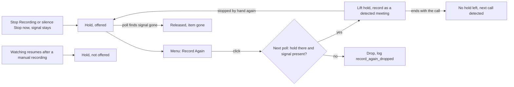

# Record a meeting again after stopping it by hand

## Conversation Evidence

The fork is public, so the owner's turns are paraphrased, not quoted.

> owner (issue #130 body, 2026-10-14, paraphrased): sometimes stops the recording of a detected meeting while the call is still going on, and then has no easy way to record the rest. The app does not detect the meeting again until the call ends. This is on purpose: Teams keeps its call signal after a call, so the app cannot tell "same call" from "next call" (log line `redetect_hold_set app=Microsoft Teams`).
> owner (issue #130 body, paraphrased): the only way today is the manual app recording, picking the meeting app again. It is not obvious, and that recording does not stop when the call ends, only when the app quits, on the silence question or at the maximum length.
> owner (issue #130 body, idea, paraphrased): while a hold is active and the call is still there, show "Record Again" where "Stop Recording" was. One click lifts the hold and starts a new recording of the same meeting, which then ends with the call like the first one.
> owner (issue #130 body, condition, paraphrased): only if new meetings are still detected reliably. After the second recording ends with the call, no hold may be left, so the next call is detected as usual. Holds are only set on a stop by hand or on the silence stop, so this should hold, but it needs a test anyway.
> owner (issue #130 body, paraphrased): the menu is being reworked in #125, so this comes after it.
> owner (issue #130 tasks, paraphrased): add the one-click item; test that the next call is detected after the second recording ends with the call; find out whether the record items were missing from the menu after the stop (they should still show).
> owner (2026-11-12, paraphrased): picked issue #130 for a spec.

## Goal & Context

When the person stops a detected meeting's recording but the call goes on, they want to record the rest of that call with one click. The new recording must end with the call by itself, as the first one would have, and the app must detect the next call as usual afterwards. [paraphrase]

What the code does today (checked on `wapp/main` at 4f3818b4): [inferred]

- **The hold.** "Stop Recording" on a detected meeting (gh-94) and "Stop now" on the long-silence question (gh-45) end the recording and place a re-detection hold on the app (`WatchLoop.holdRedetection(of:)`, state in `RedetectionHolds`). While held, the app is neither recorded nor asked about ("Record … meeting?"). The first watching poll that finds the held meeting's signal gone releases the hold. Stop Watching discards all holds. When watching resumes after a manual recording (gh-105), every call signalling at that moment gets the same hold (`WatchLoop+ResumeHold.swift`). [inferred]
- **No way back into the held call.** The only way to record a held call is a manual recording ("Record with Options…", which the issue calls "Record App + Microphone…"). A manual recording ends on "Stop Recording", when the recorded app quits, on the silence question or at the 4-hour cap, never when the call ends. [inferred]
- **The menu after a stop by hand.** The loop is back to watching. Directly under the status line the menu shows "Stop Watching for Meetings". Under "Record & Import" it shows "Record Microphone Only" and "Record with Options…": `MenuBarView.recordAndImportSection` hides them only while a recording runs. So the record items do show after the stop; this answers the issue's third task, and R6 pins it with a test. [inferred]
- **Order of work.** The menu rework the issue waits for is done: #125 (2026-10-14), and the later menu sections of gh-170 and gh-208. [inferred]

The user effect after this spec: after stopping a detected meeting's recording while the call goes on, the menu shows "Record Again (Microsoft Teams)" directly under the status line. One click records the rest of that call as a new recording. It ends and is processed exactly like a detected meeting's recording, and afterwards the app detects the next call as usual. [paraphrase]

<!-- Source: 0% user / 30% [paraphrase] / 70% [inferred] -->

## Architecture & Data Models

- **A hold says whether it may be offered.** `RedetectionHolds` keeps, per held app, whether the hold may be offered for "Record Again". A hold placed when a detected meeting's recording ended while its signal stayed (gh-94's stop by hand, gh-45's silence stop) is offered. A hold placed by the resume snapshot (gh-105) is not (A1). The release rule does not change. `RedetectionHolds` also gains a way to lift one app's hold and hand back its meeting. [inferred]
- **The offer (WatchLoop).** A new `WatchLoop+RecordAgain.swift` exposes the offers: one per offered hold, carrying the app's identity key and the name a person reads (`pattern.appName`, falling back to the owner name as the consent prompt does). The list is empty unless the loop's state is `.watching`. It is derived from the loop's observable state, so the menu updates when a hold is placed, released or lifted. [inferred]
- **The request (WatchLoop).** `recordAgain(identityKey:)` parks a request and returns true only while the loop is watching and that app has an offered hold. A repeat before the next poll keeps the one request. The watch loop's poll takes the request right after `releaseEndedRedetectionHolds()` and before an approved consent answer and detection. If that app's offered hold is still there and `detector.isMeetingActive` reports its meeting, the poll lifts the hold, logs `record_again`, and calls `runMeeting` with the held meeting. There is no consent question and no confirmation polls: the click is the person's answer. Otherwise the poll drops the request and logs `record_again_dropped`. `stop()` clears a parked request with the holds. [inferred]
- **The recording is a detected meeting's recording.** It runs through `runMeeting` and `handleMeeting` like every detected meeting: the held meeting's process and title, the same sources, every end rule (end grace and gh-54's question, the new-call split, the duration cap, "Stop Recording", the long-silence question, Stop Watching), pause, live captions, the participant read, the job or the record-only sidecar with `trigger=auto`. Watching never stops, so gh-105's resume is not involved. After the recording, `runMeeting` resets the detector for the app as after every detected meeting. A hold exists afterwards only if this recording was again ended while its signal stayed. [inferred]
- **Controller, state and menu.** `WatchingController` forwards the click to its watch loop in a new extension file and does nothing without a watching loop. `AppState` gets a single-member accessor for the offers in an extension file. `MenuBarView` gets the offers and `MenuActions` an optional `recordAgain` action that is handed the offer it was shown with, like `answerConsent`, so a click on a stale menu asks for exactly that app and is refused when its hold is gone. In `sessionControls`, while no recording runs, each offer is its own button "Record Again (<App>)", directly under the status line, followed by the watch toggle on the next line. The button has an `A11yID` constant and no keyboard shortcut. [inferred]
- **Diagnostic lines** go through the loop's `diagnostics` sink: `record_again app=<identityKey>` when a click starts a recording (this line also marks the end of the hold, so no `redetect_hold_released` line follows), and `record_again_dropped app=<identityKey>` when the parked click finds the call over. No meeting title, participant or transcript text. [inferred]

## API Contracts

None outward: no `/v1` route, `/state` field, notification or file format changes, because the feature is one menu item and the watch loop's own poll. The only new observable output is the two diagnostic log lines above, which tests pin. [inferred]

## Edge Cases & Constraints

- **The call ends before the click is acted on.** The item can stay up to one poll after the call ended, because holds are released only by a watching poll. The poll releases the hold first, then drops the parked click with `record_again_dropped`; nothing records. [inferred]
- **Latency.** The click is acted on at the loop's next poll, up to one poll interval later (3 s by default, 1–30 s in Settings), like the menu's consent "Record". Audio of that gap is not recorded (A2). [inferred]
- **A stale menu.** A click whose hold is gone (released, lifted, or discarded by Stop Watching), or that comes while a recording runs or the loop is not watching, changes nothing and logs nothing. Two clicks before the poll start one recording. [inferred]
- **Other apps.** Recordings start only at a poll, and the parked click comes first in it, so it wins that poll. Another app's call is detected after the new recording ends, as during any recording today. An approved consent answer for another app that waits at the same poll stays parked and is handled as today after the recording (re-checked against its signal). An open prompt for another app stays open, as during any detected recording. [inferred]
- **Several held apps.** Each offered hold has its own item, sorted by app name. A click lifts only its own app's hold; the other holds and their items stay. [inferred]
- **Consent settings are not consulted.** "Record Without Asking" and the "Never for this app" list are not read for the click: it is an explicit start, like a manual recording. [inferred]
- **The recorder fails to start.** The failure is reported as for any detected meeting (error state, notification, no job). The hold is not placed again, so after the error pause the still-running call is detected anew and asked about or recorded by its app's setting. [inferred]
- **Error state.** After a recording whose stop failed, the loop sits in its error state for its usual pause. No item shows until it is back to watching; the hold is already in place then. [inferred]
- **Stopped again.** If the new recording is again stopped by hand, or by the silence question, while the signal stays, the app is held again and the item shows again. This repeats without limit. [inferred]
- **Ended by the cap or a new call.** The duration cap and Teams' new-call split end the new recording without a hold, exactly as for any detected recording. [inferred]
- **Stop Watching, a manual start, a quit.** Each goes through the loop's `stop()`, which discards holds and a parked click, so no item shows afterwards. [inferred]
- **Two jobs.** The first part's job is not changed. The new recording is its own job, titled with the held meeting's title, with default protocol options (A4). [inferred]
- **Line limits.** `WatchLoop.swift` (598 lines), `AppState.swift` (600) and `MeetingTranscriberApp.swift` (599) sit at SwiftLint's 600-line `file_length` limit, and lint runs `--strict`. New logic goes into extension files. Any line a main file needs, such as the poll hook or the menu wiring, is paid for by moving existing code out first. [inferred]
- **Both build variants** get the item; nothing here is `#if !APPSTORE`. [inferred]
- **No real meeting content in tests.** The tests use the scripted detector and mock recorder of the existing `WatchLoop` suites. A live check with a real call (stop by hand, Record Again, end the call, start a next call) is for the owner, not a task. [inferred]

## Acceptance Criteria

- **R1:** After a detected meeting's recording was ended by "Stop Recording" or by "Stop now" on the long-silence question while its call signal stayed, and while watching runs and no recording runs, the menu shows "Record Again (<App>)" directly under the status line, with "Stop Watching for Meetings" on the line below. The item goes away when the hold is released (the first watching poll that finds the signal gone), when any recording starts, and on Stop Watching. Errors: not shown while the loop is in its error state; not shown for a call held because watching resumed after a manual recording (A1). Tests: `WatchLoopRecordAgainTests` (offers after each kind of stop, none after the resume snapshot) and `MenuBarViewSessionControlsTests` (order of the lines, one item per offer). [paraphrase]
- **R2:** A click on the item starts, at the watch loop's next poll, a new recording of the same meeting (same app, process and meeting title). It does not ask "Record … meeting?", also for an app that asks first, and does not wait for detection to confirm. The hold is lifted, and the menu then shows "Stop Recording" as for any detected recording. Errors: if that poll finds the hold released or the signal gone, nothing records and `record_again_dropped` is logged; a click from a stale menu changes nothing; two clicks before the poll start one recording; a recorder that fails to start is reported as for any detected meeting and the hold is not placed again. Tests: `WatchLoopRecordAgainTests`, and a `MenuBarViewSessionControlsTests` wiring test that a tap passes its own offer. [paraphrase]
- **R3:** The new recording ends and is processed exactly as a detected meeting's recording: through the end grace and gh-54's question, Teams' new-call split, the duration cap, "Stop Recording", the long-silence question, or Stop Watching. It makes one job (or, in record-only mode, its WAVs and a sidecar with `trigger=auto`), and the first part's job is unchanged. Errors: as for any detected recording. Test: `WatchLoopRecordAgainTests` (ends after the call hangs up, one more job enqueued). [paraphrase]
- **R4:** After the new recording ended with the call, no hold is left for the app (`appsHeldFromDetection` is empty), and the app's next call is detected, then asked about or recorded as its setting says. If the new recording is instead ended by hand, or by the silence question, while the signal stays, the app is held again and R1's item shows again. Errors: none beyond the detector's own. Test, as the issue asks: `WatchLoopRecordAgainTests.testTheNextCallIsDetectedAfterARecordAgainRecordingEndsWithTheCall`, once for an app that records without asking and once for one that asks first. [paraphrase]
- **R5:** Everything else about holds stays as it is: gh-94's and gh-45's holds still keep the app out of detection until one poll finds its signal gone, gh-105's resume still holds every signalling call, other apps are detected during a hold, a click lifts only its own app's hold, and Stop Watching discards every hold and a parked click. Errors: none. Tests: `RedetectionHoldsTests` (offered and not offered holds, lifting one app), and `WatchLoopStopByHandTests`, `WatchLoopSilencePromptDetectedTests` and `WatchLoopResumeHoldTests` stay green with what they assert unchanged. [paraphrase]
- **R6:** While watching runs and no recording runs, after a stop by hand included, the menu shows "Record Microphone Only" and "Record with Options…" under "Record & Import"; they stay hidden while any recording runs. Errors: none. Test: a `MenuBarViewSessionControlsTests` case with a Record Again offer that finds both record items. [paraphrase]
- **R7:** A click that starts a recording writes `record_again app=<identityKey>`, and a dropped click writes `record_again_dropped app=<identityKey>`, to the diagnostic log the app keeps on disk. No line carries a meeting title, participant name or transcript content. `docs/architecture/detection.md` describes the re-detection hold (who places it, its release rule) and Record Again, and `docs/architecture-macos.md` lists the new files. Errors: none beyond the log write itself. Test: the log assertions in `WatchLoopRecordAgainTests`. [inferred]

## Boundaries

- Not in this spec: "Record Again" for a call held because watching resumed after a manual recording (A1). [inferred]
- Not in this spec: a `/v1` verb, a `/state` field, an `mt-cli` command or a Stream Deck key for Record Again. [inferred]
- Not in this spec: a keyboard shortcut for the item. [inferred]
- Not in this spec: joining the two parts into one job or protocol; carrying the first part's "Record with Options…" choices over (A4). [inferred]
- Not in this spec: acting on the click at once instead of at the next poll (A2). [inferred]
- No change to the hold's release rule, gh-54's question, the end grace, the duration cap, detection's consent rules, or how manual recordings end. No notification when Record Again starts or is dropped. [inferred]
- The re-detection hold and "Stop Recording" for detected meetings exist only in the fork (gh-94), so this is not offered to the original project. [inferred]

## Decision Context

- **D1 · While a hold is active and the call is still there, the menu shows "Record Again" where "Stop Recording" was; one click lifts the hold and starts a new recording of the same meeting.** why: issue #130 body, Notes (2026-10-14) · status: active [owner-stated 2026-10-14]
- **D2 · The new recording ends with the call like the first, detected one; it is not a manual recording.** why: issue #130 body, Notes, and Background: a manual recording does not stop when the call ends (2026-10-14) · status: active [owner-stated 2026-10-14]
- **D3 · After the second recording ends with the call, no hold is left and the next call is detected as usual, proven by a test.** why: issue #130 body, Notes ("Condition") and Tasks (2026-10-14) · status: active [owner-stated 2026-10-14]
- **D4 · The record items stay in the menu after a stop by hand.** why: issue #130 Tasks, "they should still show" (2026-10-14); the code already shows them, R6 pins it · status: active [owner-stated 2026-10-14]
- **A1 · "Record Again" is offered only for a hold placed when a detected meeting's recording ended while its signal stayed (stop by hand, silence stop), not for calls held when watching resumes after a manual recording.** flip at: the owner wants it for every held call · test: the resume-snapshot case in `WatchLoopRecordAgainTests` · status: active [agent-assumed 2026-11-12]
- **A2 · The click is acted on at the watch loop's next poll (up to the poll interval, 3 s by default), as the menu's consent "Record" is, rather than waking the loop at once.** flip at: the owner notices the missing seconds at the start of the new recording · test: `WatchLoopRecordAgainTests` (starts at the poll after the click) · status: active [agent-inferred 2026-11-12]
- **A3 · One item per offered hold, labelled "Record Again (<App>)", directly under the status line, without a keyboard shortcut.** flip at: the owner wants the bare label "Record Again" or a shortcut · test: `MenuBarViewSessionControlsTests` · status: active [agent-assumed 2026-11-12]
- **A4 · The new recording uses the held meeting's process and title and default protocol options; the first part's "Record with Options…" choices are not carried over.** flip at: the owner wants the first part's options on the second part · test: the job assertion in `WatchLoopRecordAgainTests` · status: active [agent-assumed 2026-11-12]
- **A5 · The new recording's record-only sidecar keeps `trigger=auto`, as gh-94's A5 does for a detected meeting stopped by hand.** flip at: a consumer of the sidecar needs to tell a Record Again recording apart · test: the record-only case in `WatchLoopRecordAgainTests` · status: active [agent-inferred 2026-11-12]
- **A6 · A recorder that fails to start for Record Again does not put the hold back, so the running call is detected anew after the error pause.** flip at: the owner prefers the call to stay held after a failed start · test: the failed-start case in `WatchLoopRecordAgainTests` · status: active [agent-assumed 2026-11-12]
