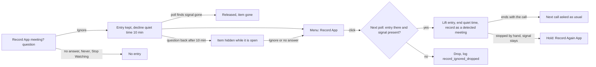

# Record a call after answering Ignore

## Conversation Evidence

The fork is public, so the owner's words are paraphrased, not quoted.

> owner (2026-11-16, paraphrased): after answering "Ignore" to the "Record … meeting?" question, the owner sometimes changes their mind while the call still runs, and then there is no way to record that call the way a detected one is recorded.
> owner (2026-11-16, paraphrased): the menu should then offer a one-click item next to the meeting watcher's entry that records that call now, and that recording should end with the call, like a detected recording.
> owner (2026-11-16, paraphrased): answering the spec's four product questions, the owner kept each proposed answer: the label "Record (<App>)" at the Record Again place with no keyboard shortcut; the ten-minute quiet time and the returning question unchanged, the item lasting until the call ends and hidden while that question is open; the item only after Ignore, not after an expired question or "Never"; and a click also ending that app's quiet time.

## Goal & Context

A person who answered "Ignore" to "Record <App> meeting?" and then wants the call recorded after all gets one menu item that records the rest of that call. The recording ends with the call by itself, as a detected meeting's recording does. [paraphrase]

What the code does today (checked on `wapp/main` at 3b236a80): [inferred]

- **Ignore.** The notification's "Ignore", the menu's "Ignore" and the prompt window's "Ignore" (gh-99) all land in the consent gate (`WatchLoop+Consent.swift`, `finishConsent`) as `ConsentAnswer.declined`. The gate records a decline (`BrowserConsentPolicy.recordDecline`, `declineCooldown` 600 s) and resets the detector for the app. [inferred]
- **The ten minutes of quiet are per app, not per call.** The app stays in detection: its call is detected again every few seconds and the gate passes over it without a word. If the call still runs after ten minutes, the question comes back (pinned by `WatchLoopBrowserConsentTests.testDeclinedBrowserMeetingRePromptsAfterCooldown`). A new call of the same app inside the ten minutes is passed over too. [inferred]
- **No answer and Never.** A question nobody answers within five minutes (`NotificationManager.consentPromptTimeout`, 300 s) is `.expired`: one minute of quiet (`expiryCooldown`), then the question comes back. "Never for this app" puts the app on `ConsentDenyList`, checked before the quiet time; the app's calls are then passed over until the person removes it in Settings → General. [inferred]
- **Stop Watching and a manual start also book a decline.** With a question open, both answer it through `declineParkedConsent`, which clears the question first and then resolves the prompt as `.declined`, so a ten-minute quiet time follows (fork issue #80 notes this). [inferred]
- **The menu during the quiet time** shows nothing about the ignored call: the question's lines are gone, the icon's question mark is gone, and `/state` has no field for the quiet time. [inferred]
- **The ways back today are hidden or wrong.** "Record with Options…" starts a manual recording: it stops watching, and it ends on "Stop Recording", when the recorded app quits, on the silence question or at the 4-hour cap, never when the call ends (`ManualRecordingMonitorPolicy`). Two other ways exist but nobody would find them: wait until the question comes back after ten minutes, or Stop Watching and Start Watching again (each start builds a new watch loop with a fresh `BrowserConsentPolicy`, so the running call is detected and asked about again). [inferred]
- **Record Again (gh-130)** is the model for this spec: an offer per held call (`RecordAgainOffer`, `WatchLoop.recordAgainOffers`), "Record Again (<App>)" directly under the status line, a click parked in `recordAgainRequest` for the next poll, and `takeRecordAgain()` recording the held meeting through `runMeeting(…, startCause: .recordAgain)`, so the recording ends with the call by every rule and posts no "Meeting Detected". A hold keeps its app out of detection until the signal is gone, so an ignored call cannot simply be held: that would also stop the question from coming back after ten minutes (D4). [inferred]

The user effect after this spec: after "Ignore", while the call still runs, the menu shows "Record (Microsoft Teams)" at the place where "Record Again (Microsoft Teams)" shows after a stop by hand. One click records the rest of the call as a detected meeting's recording, which ends with the call. Afterwards the app's next call is asked about as usual. [paraphrase]

<!-- Source: 0% user / 25% [paraphrase] / 75% [inferred] -->

## Architecture & Data Models

- **Ignored calls, a pure value.** A new value type keeps, per app identity key, the meeting the person ignored. It can remember a meeting (a later Ignore for the same app replaces the entry with the newer meeting), release every entry whose meeting a check reports over and return those apps, lift one app's entry and hand back its meeting only when a check reports it still active, forget one app, and forget all. Like `RedetectionHolds` it never asks a detector; the loop passes the checks in. [inferred]
- **Who places an entry.** `finishConsent` places it on a `.declined` answer to the question that was still the open one when the answer landed, while the loop is active, after it records the decline and resets the detector as today. So an Ignore from the notification, the menu, the prompt window or `POST /action/confirmBrowserConsent` places one. A decline that `declineParkedConsent` booked for Stop Watching or a manual start does not, because that path clears the question before the answer lands. `.expired` and `.never` place none (D5), and a `.never` forgets the app's entry. [inferred]
- **Who removes an entry.** The first watching poll that finds the meeting's signal gone (`detector.isMeetingActive` false) releases it, at the same step as `releaseEndedRedetectionHolds()`. A recording of that app that starts by any path (the click, an approved answer, an app switched to Record Without Asking, a new-call split) forgets it. `stop()` forgets all, as it discards the holds. The end of the ten-minute quiet time does not remove it (D4). [inferred]
- **The offer.** `RecordAgainOffer` gains a kind: a held call (today's "Record Again") or an ignored call. `recordAgainOffers` lists both kinds, empty unless the loop's state is `.watching`, sorted by the name a person reads. An ignored call is left out while a question about that same app is open, because that question's own "Record" is the way then (D4). An app never has both kinds at once: a hold follows a recording, and any recording of the app forgets its ignored entry. [inferred]
- **The click.** `recordAgain(identityKey:)` takes a click on either kind under its current rules (only while watching, only for an offer it lists, one parked click per poll, a click for another app refused while one waits). The poll's `takeRecordAgain()` handles an ignored call like a held one: if the entry is there and its meeting is active, it lifts the entry, ends the app's decline quiet time (D6), drops an approved consent answer for another app, marks the app confirmed in the detector (`markConfirmed(appName:)`: the decline reset its count, and a new-call split relies on that count), and returns the meeting for `runMeeting(…, startCause: .recordAgain)`. Otherwise it drops the click. There is no consent question and no confirmation poll: the click is the person's answer, for this call only. A next call that a new-call split finds goes through the consent gate as after any detected recording (`WatchLoop.swift`, the `.replacedByNewCall` branch of `runMeeting`): an app that asks gets its question, since the click ended the quiet time. [inferred]
- **Ending one app's quiet time.** `BrowserConsentPolicy` gains a mutating call that removes one app's suppression. It never touches the deny list, which is checked apart from the policy. Only the click's poll calls it. [inferred]
- **The recording is a detected meeting's recording.** It runs through `runMeeting` and `handleMeeting` with the ignored meeting's process and title: every end rule (end grace and gh-54's question, the new-call split, the duration cap, "Stop Recording", the long-silence question, Stop Watching), pause, live captions, the participant read, and one job, or in record-only mode its WAVs and a sidecar with `trigger=auto`. Its move into `.recording` carries `PhaseChangeCause.recordAgain`, so `WatchingController` posts no "Meeting Detected" for it (A5). [inferred]
- **Menu.** `MenuBarView.recordAgainItems` shows each offer on its own line, directly under the status line and above the watch toggle: "Record Again (<App>)" for a held call as today, "Record (<App>)" for an ignored call (D3). The ignored call's line has its own `A11yID` constant and no keyboard shortcut. `MenuActions.recordAgain` and `WatchingController.recordAgain(_:)` already hand the offer that was shown to the loop and need no change. [inferred]
- **Diagnostic lines** go through the loop's `diagnostics` sink, with the identity key only: `ignore_offer_set app=<key>` when an entry is placed, `ignore_offer_released app=<key>` when a poll releases it, `record_ignored app=<key>` when a click starts a recording, and `record_ignored_dropped app=<key>` when the parked click finds the call over. No meeting title, participant or transcript text. [inferred]

## API Contracts

None outward: no `/v1` route, `/state` field, notification or file format changes. The only new observable output is the four diagnostic lines above, which tests pin. [inferred]

## Edge Cases & Constraints

- **The call ends before the click is acted on.** The item can stay up to one poll after the call ended. That poll releases the entry first and then drops the click with `record_ignored_dropped`; nothing records. [inferred]
- **Latency.** The click is acted on at the next poll, up to one poll interval later (3 s by default, 1 to 30 s in Settings), as Record Again and the menu's consent "Record" are. Audio of that gap is not recorded. [inferred]
- **A stale menu.** A click whose entry is gone (released, lifted, forgotten), or that comes while a recording runs, while the loop is not watching, or while a question about that app is open again, changes nothing and logs nothing. Two clicks before the poll start one recording. [inferred]
- **The question comes back.** After ten minutes with the call still running, the app is asked again as today, and the item hides while that question is open. "Record" on it records as today and forgets the entry. "Ignore" places the entry again with the newer meeting. No answer leaves the entry, so the item shows again once the question has expired. "Never for this app" forgets the entry. [inferred]
- **Other apps.** The parked click comes first in its poll and wins it. An approved consent answer for another app that waits at the same poll is dropped without a decline, as for Record Again ("an approval is not a reservation"). An open question about another app stays open, as during any detected recording. [inferred]
- **Several ignored or held apps.** Each offer has its own line, sorted by app name. A click lifts only its own app's entry or hold. [inferred]
- **Consent lists.** "Record Without Asking" is not read for the click: it is an explicit start. A denied app never has an entry, because "Never" forgets it and a denied app is never asked. [inferred]
- **The recorder fails to start.** The failure is reported as for any detected meeting (error state, notification, no job). The entry is not placed again. The click already ended the quiet time, so after the error pause the still-running call is detected and asked about anew. [inferred]
- **Error state.** No item shows while the loop is in its error state. [inferred]
- **A lingering signal.** An app that keeps its call signal after the call (the reason gh-94 holds exist) can keep the item in the menu after the call ended, until the signal goes, as with Record Again. A click then records until the end rules stop it. The same holds for a browser tab that keeps its WebRTC assertion on a page with no meeting. [inferred]
- **Browser meetings.** The entry is keyed by the concrete browser, as the quiet time is, so the item reads "Record (Google Chrome)". [inferred]
- **Stop Watching, a manual start, a quit.** Each goes through `stop()`, which forgets every entry and a parked click. [inferred]
- **Line limits.** `WatchLoop.swift` has 600 lines, at SwiftLint's `file_length` limit, and lint runs `--strict`; `MeetingTranscriberApp.swift` (598), `WatchingController.swift` (585) and `AppState.swift` (583) are close to it (counts at 3b236a80). New logic goes into extension files and the new value type's own file. Any line `WatchLoop.swift` needs, such as the stored entries, is paid for by moving existing code out first. [inferred]
- **Both build variants** get the item; nothing here is `#if !APPSTORE`. [inferred]
- **No real meeting content in tests.** The tests use the scripted detector, the parking notifier doubles and the mock recorder of the existing `WatchLoop` suites, and for the split the real `PowerAssertionDetector` on injected assertions, as `WatchLoopRecordAgainSplitTests` does. A live check with a real call (Ignore, change your mind, click, end the call, start the next call) is for the owner, not a task. [inferred]

## Acceptance Criteria

- **R1:** After the person answers "Ignore" to a "Record <App> meeting?" question (in the notification, the menu or the prompt window) while watching runs, and while that call's signal stays and no recording runs, the menu shows "Record (<App>)" directly under the status line, with "Stop Watching for Meetings" on the line below, where "Record Again (<App>)" shows after a stop by hand. Errors: no item after a question that expired unanswered, after "Never for this app", or after a decline that Stop Watching or a manual start booked; no item while the loop is in its error state; the item hides while a question about that app is open. Tests: the new ignored-call value's unit tests, `WatchLoopRecordIgnoredTests` (an item after each Ignore path, none after the other answers), and `MenuBarViewSessionControlsTests` (the label, the order of the lines, one line per offer). [paraphrase]
- **R2:** The item goes away at the first watching poll that finds the call's signal gone, when any recording of that app starts, when the app gets "Never for this app", and on Stop Watching, a manual start or a quit. The ten-minute quiet time and the question that comes back after it stay as they are; a later "Ignore" or an expired question shows the item again while the call runs. Errors: none beyond R1. Tests: `WatchLoopRecordIgnoredTests` (each way the item goes away; the question comes back after ten minutes and hides the item), and `WatchLoopBrowserConsentTests` stays green with what it asserts unchanged. [inferred]
- **R3:** A click on the item starts, at the watch loop's next poll, a new recording of the ignored meeting (same app, process and meeting title). It asks no question, waits for no detection to confirm, and posts no "Meeting Detected" notification; the menu then shows "Stop Recording" as for any detected recording. Errors: if that poll finds the entry released or the signal gone, nothing records and `record_ignored_dropped` is logged; a click from a stale menu changes nothing; two clicks before the poll start one recording; a click for another app while one waits is refused; a recorder that fails to start is reported as for any detected meeting and the entry is not placed again; an approved consent answer for another app waiting at that poll is dropped without a decline. Tests: `WatchLoopRecordIgnoredTests`, and a `MenuBarViewSessionControlsTests` wiring test that a tap on "Record (<App>)" passes the offer it shows. [paraphrase]
- **R4:** The new recording ends and is processed exactly as a detected meeting's recording: through the end grace and gh-54's question, the new-call split, the duration cap, "Stop Recording", the long-silence question, or Stop Watching. It makes one job (or, in record-only mode, its WAVs and a sidecar with `trigger=auto`). At a new-call split the next call is detected at the split poll, also when the click came right after the Ignore, and passes the consent gate as any detected call does: an app that asks before recording gets its question at that poll and nothing records until it is answered; an app set to Record Without Asking starts the next recording at that poll. If the person stops it by hand, or on the silence question, while the signal stays, the app is held and "Record Again (<App>)" shows. Errors: as for any detected recording. Tests: `WatchLoopRecordIgnoredTests` (ends after the call hangs up, one job enqueued; stopped by hand gives the Record Again offer) and, with the real `PowerAssertionDetector` on injected assertions, Ignore, click, switch the call ID: for an app that asks, the question opens at the split poll and no second recording starts; with the app switched to Record Without Asking after the Ignore, the next recording starts at the split poll. [paraphrase]
- **R5:** A click ends that app's decline quiet time: after the new recording ended with the call, the app's next call is asked about, or recorded as its setting says, also when it starts within ten minutes of the Ignore. Without a click the quiet time runs as today. Errors: the deny list is never changed by this. Tests: `BrowserConsentPolicyTests` (ending one app's suppression leaves other apps and every denial as they were) and `WatchLoopRecordIgnoredTests.testTheNextCallIsAskedAboutAfterTheIgnoredCallWasRecorded`. [inferred]
- **R6:** Record Again, the holds and the consent gate behave as before for everything this spec does not name. Errors: none. Tests: `WatchLoopRecordAgainTests`, `WatchLoopRecordAgainSplitTests`, `RedetectionHoldsTests`, `WatchLoopAskBeforeRecordingTests` and `WatchLoopBrowserConsentTests` stay green with what they assert unchanged. [inferred]
- **R7:** The four lines `ignore_offer_set`, `ignore_offer_released`, `record_ignored` and `record_ignored_dropped`, each with `app=<identityKey>`, go to the diagnostic log the app keeps on disk. No line carries a meeting title, participant name or transcript content. `docs/architecture/detection.md` describes the item next to Record Again, and `docs/architecture-macos.md` lists the new file. Errors: none beyond the log write itself. Test: the log assertions in `WatchLoopRecordIgnoredTests`. [inferred]

## Boundaries

- Not in this spec: the item after a question that expired unanswered, or after "Never for this app" (D5). [inferred]
- Not in this spec: a change to the ten-minute quiet time or to the question that comes back after it (D4). [inferred]
- Not in this spec: a `/v1` verb, a `/state` field, an `mt-cli` command, a Stream Deck key or a keyboard shortcut for the item. [inferred]
- Not in this spec: protocol options for the click's recording; it uses the defaults, as Record Again does. [inferred]
- Not in this spec: acting on the click at once instead of at the next poll. [inferred]
- Not in this spec: the shared question mechanic and the decline that Stop Watching books (fork issue #80). [inferred]
- The item builds on Record Again and the re-detection hold, which exist only in the fork (gh-94, gh-130), so it is not offered to the original project. [inferred]

## Decision Context

- **D1 · After "Ignore", while the call still runs, the menu offers a one-click item next to the meeting watcher's entry that records that call now.** why: owner's wish of 2026-11-16, paraphrased in Conversation Evidence · status: active [owner-stated 2026-11-16]
- **D2 · The recording that item starts ends with the call like a detected recording; it is not a manual recording.** why: owner's wish of 2026-11-16, paraphrased in Conversation Evidence · status: active [owner-stated 2026-11-16]
- **A1 · The item reads "Record (<App>)" and sits where "Record Again (<App>)" sits, directly under the status line and above the watch toggle, without a keyboard shortcut.** alternatives: B - the same label "Record Again (<App>)" for both kinds; C - "Record <App> Meeting", echoing the question · flip at: the owner's answer · test: `MenuBarViewSessionControlsTests` · status: superseded by D3 [agent-assumed 2026-11-16]
- **A2 · The item stays until the call's signal is gone; the ten-minute quiet time and the question that comes back after it stay as today, and the item hides while that question is open.** alternatives: B - Ignore covers the whole call: the app is held out of detection until the call ends, so it is asked once per call, and the next call is asked as usual · flip at: the owner's answer · test: `WatchLoopRecordIgnoredTests` (the question comes back after ten minutes and hides the item) · status: superseded by D4 [agent-assumed 2026-11-16]
- **A3 · The item follows only an "Ignore"; it never follows a question that expired unanswered, "Never for this app", or a decline that Stop Watching or a manual start booked.** alternatives: B - also after a question that expired unanswered · flip at: the owner's answer · test: `WatchLoopRecordIgnoredTests` (no item after each of those answers) · status: superseded by D5 [agent-assumed 2026-11-16]
- **A4 · A click ends that app's ten-minute quiet time, so its next call is asked about as usual once the new recording ended.** alternatives: B - the quiet time runs on, and a next call within ten minutes of the Ignore passes unasked as today · flip at: the owner's answer · test: `WatchLoopRecordIgnoredTests.testTheNextCallIsAskedAboutAfterTheIgnoredCallWasRecorded` · status: superseded by D6 [agent-assumed 2026-11-16]
- **A5 · The click's recording starts like a Record Again recording: `PhaseChangeCause.recordAgain` (no "Meeting Detected"), default protocol options, and `trigger=auto` in the record-only sidecar.** flip at: the owner wants a notice, options or a distinct trigger for it · test: `WatchLoopRecordIgnoredTests` (the start cause, the job, the record-only case) · status: active [agent-inferred 2026-11-16]
- **A6 · An ignored call is kept in its own value next to `RedetectionHolds`, and the offer list carries a kind, because a hold keeps its app out of detection and would stop the question from coming back.** alternatives: B - place an offered hold on Ignore, which is A2's option B · flip at: D4 changes · test: the ignored-call value's unit tests · status: active [agent-inferred 2026-11-16]
- **A7 · A recorder that fails to start for the click does not put the entry back, as gh-130's A6 decides for Record Again.** flip at: the owner prefers the item to come back after a failed start · test: the failed-start case in `WatchLoopRecordIgnoredTests` · status: active [agent-inferred 2026-11-16]
- **D3 · The item reads "Record (<App>)" and sits where "Record Again (<App>)" sits, directly under the status line and above the watch toggle, with no keyboard shortcut.** why: the owner's answer to the spec's product questions, 2026-11-16, paraphrased in Conversation Evidence · alternatives: B the label "Record Again (<App>)" for both kinds; C "Record <App> Meeting" · status: active [owner-stated 2026-11-16]
- **D4 · The ten-minute quiet time and the question that comes back after it stay as today; the item lasts until the call's signal is gone and hides while that question is open.** why: the owner's answer to the spec's product questions, 2026-11-16, paraphrased in Conversation Evidence · alternatives: B Ignore covers the whole call and holds the app out of detection until it ends · status: active [owner-stated 2026-11-16]
- **D5 · The item shows only after an "Ignore": never after a question that expired unanswered, never after "Never for this app"; a decline that Stop Watching or a manual start books is not an Ignore and gives none.** why: the owner's answer to the spec's product questions, 2026-11-16, paraphrased in Conversation Evidence; the Stop Watching and manual-start case is the agent's reading of "only after Ignore" · alternatives: B also after an expired question · status: active [owner-stated 2026-11-16]
- **D6 · A click on the item also ends that app's ten-minute quiet time, so the app's next call is asked about as usual.** why: the owner's answer to the spec's product questions, 2026-11-16, paraphrased in Conversation Evidence · alternatives: B the quiet time runs on and a next call within ten minutes passes unasked · status: active [owner-stated 2026-11-16]

FIT: GO · 2026-11-16 · base 3b236a80 · engine flow-next 9.10.0 · captured today on the current base; nothing relevant moved
  - `origin/wapp/main` is still 3b236a80; specs and design docs changed since capture only for gh-256 (device live levels), gh-171 (diarization doc) and an upstream docs branch, none of which touch the consent gate, Record Again or the menu
  - every code anchor checked at 3b236a80: `finishConsent`, `declineParkedConsent`, `BrowserConsentPolicy` (600 s / 60 s), `consentPromptTimeout` 300 s, `RecordAgainOffer`, `recordAgainOffers`, `recordAgain(identityKey:)`, `takeRecordAgain()`, `releaseEndedRedetectionHolds()`, `markConfirmed(appName:)`, `stop()`, `A11yID.recordAgainMenuItem`, the named test classes, and the line counts (600 / 598 / 585 / 583 against a `file_length` warning at 600)
  - the original project has no open issue or pull request about recording a call after declining its consent question
