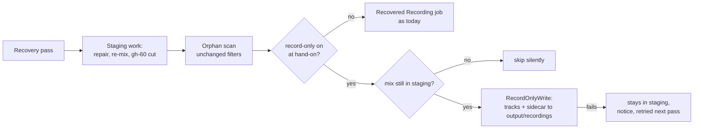

# Record-only mode: file a recording recovered after a crash instead of processing it

## Conversation Evidence

The fork is public, so the owner's turns are paraphrased, not quoted. The issue is written in German; this spec is in English.

> owner (issue #77, filed 2026-10-06 while planning #60, paraphrased): with record-only mode on, if the app crashes during a recording, the next start's recovery brings the recording back and always sends it into processing (transcription, speakers, protocol), instead of only filing it with its sidecar file as record-only mode does.
> owner (issue #77, wish, paraphrased): recovery follows the same mode as a recording that ended normally: in record-only mode, file the recording instead of processing it.
> owner (issue #77, acceptance, paraphrased): record-only on, a recording running, the app ended hard; after the restart the recording and its sidecar are in the output folder, and no transcription job runs.
> owner (2026-11-12, paraphrased): picked this issue for a spec.

## Goal & Context

Record-only mode (Settings → General) is for a Mac that only captures meetings: every recording goes into `<output folder>/recordings/` as audio files plus a `<stem>_meta.json` sidecar (a small JSON file with title, times and file names), and another machine processes them. Nothing is transcribed on this Mac. [inferred]

That promise holds when a recording ends normally and, since the quit finishes the recording, when the app is quit normally (`WatchLoop+Quit.swift`). It breaks when the app dies during a recording (crash, force quit, power loss): the next start's recovery finds the recording in the app's staging folder (the private folder the recorder writes to) and queues it as a "Recovered Recording (<stem>)" job for full processing. [paraphrase]

Why it matters:

- **The meeting is processed on a machine set up not to process it.** The protocol settings stay set while record-only dims them, so a recovered recording can send its transcript to the configured protocol provider (Claude CLI or an API). [inferred]
- **The external pipeline never gets it.** No sidecar is written, so the machine that expects the recording in the output folder does not see it as a record-only recording. [inferred]

The user effect after this spec: in record-only mode, a recording that the app died during lands in `<output folder>/recordings/` with its sidecar after the next recovery, exactly like a normally stopped one, and no job appears in the menu. With record-only off, recovery is unchanged. [paraphrase]

**Reproduction today** (a development build only, never the installed app): turn record-only on, start a manual recording, let it run for a minute, end the app process with SIGKILL, start the app again and start watching. A "Recovered Recording (<stem>)" job appears and transcription starts; `<output folder>/recordings/` gets no sidecar for it. The cheaper reproduction is the fixture test named in R1. [inferred]

The same gap also catches two other recordings that reach recovery: a live record-only write that failed (its sources stay in staging) and a quit whose time budget ran out during the write. Both are processed today; after this spec both are filed. [inferred]

Spec gh-60 (cut a recovered recording, done) left this gap open on purpose: its Boundaries and its A5 say recovery queues every recovered recording for processing, record-only included, and writes no sidecar. [inferred]

<!-- Source: 0% user / 30% [paraphrase] / 70% [inferred] -->

## Architecture & Data Models

- **Where the decision sits.** The staged recovery pass (`PipelineController.startStagedRecovery`, file `PipelineController+ProductionEnvironment.swift`) first does its staging work (header repair, re-mix of crashed recordings, gh-60's stored cuts), then the orphan step (`PipelineController.recoverOrphans`, same file, which calls `PipelineQueue.recoverOrphanedRecordings` in `PipelineQueue+OrphanRecovery.swift`: `scanForOrphanedRecordings`, then `adoptOrphanedRecordings`) finds the recordings no job tracks and gives each a job. The record-only branch goes at that hand-on point: the scan stays exactly as it is (same filters, same held-back recordings, same 24-hour limit), and in record-only mode the scanned recordings are written as record-only output instead of becoming jobs. [inferred]
- **Built on the original's split of the orphan scan, now in `wapp/main`.** The original's PR 950 split orphan recovery into a scan and an adoption (`scanForOrphanedRecordings`, `adoptOrphanedRecordings`, in `PipelineQueue+OrphanRecovery.swift`), and its PR 949 makes a failed record-only write remove the files it had already placed (the `placed` rollback in `RecordOnlyWrite.perform`). Both arrived with the fork's upstream merge (PR 227; upstream-sync issue #211 is closed). The record-only branch goes between that scan and that adoption, in place of the adoption (A8). [inferred]
- **The setting and the destination come from the controller.** `PipelineController` already owns the settings and the `OutputDirectoryResolver`, and already passes the level-balance flag into the pass (a value taken at queue build, through `QueueEnvironment.recoverStagedRecordings`). It also hands the pass a record-only reader (a closure over `settings.recordOnly`, as the watch loops get one in `WatchingController+LoopFactory.swift`), the record-only destination (`RecordOnlyDestination.production(parent: outputDirectory.resolve())`, as the watch loops build it there) and its notifier. The reader is called when the pass hands the recordings on, after its staging work (A1). The destination is resolved per write, so the output-folder fallback and its one-time notice apply unchanged. [inferred]
- **Each recording is written by `RecordOnlyWrite`**, the type a live stop uses (`WatchLoop+RecordOnly.swift`): the same `<output folder>/recordings/` folder, the same free-stem rule (nothing in the folder is overwritten), the same commit order (complete copies under temporary names, renamed, sidecar committed last, staging sources removed only after the commit). The file work runs off the main actor, as the quit path's `writeRecordOnlyOffMain` does, because the output folder can be on another volume. [inferred]
- **A recovered recording has no job.** No queue entry, no snapshot entry, no event-log entry, no meeting-file record (the record the "All recordings" list and the fork's deletion gate read) and no `RecordingRetentionRegistry` entry (the list automatic deletion works from), the same as a live record-only stop. [inferred]
- **The sidecar's trigger may be absent.** `RecordingSidecar` and `RecordOnlyWrite` accept "no trigger"; the encoder then leaves the `trigger` key out. Live stops still always write one. Reading already treats the key as optional. [inferred]
- **Docs:** `docs/architecture/pipeline.md`, section "Record-only mode", names recovery as the third path into the record-only branch and describes the recovered sidecar, in the same commit as the code. [inferred]

## API Contracts

The contract is the sidecar a recovered recording gets, read by the external pipeline and by the app's own re-import. No `/v1` or debug RPC change.

- **Recovered-recording sidecar** (`<stem>_meta.json` beside its tracks in `<output folder>/recordings/`): [inferred]

  | Field | Value for a recovered recording |
  |---|---|
  | `version` | the current version (3) |
  | `title` | `Recovered Recording (<stem>)`, the title the processing path gives the same recording |
  | `appName` | `Unknown` |
  | `startedAt` | the recording's start, read from its stem (the recorder names each recording by its local start time, `yyyyMMdd_HHmmss`) |
  | `stoppedAt` | `startedAt` plus the length of the mix as written (after any gh-60 cut) |
  | `participants` | empty |
  | `micDelaySeconds` | 0 (recovered tracks are aligned at their file starts, as on the processing path) |
  | `trigger` | key absent: how the recording was started is not known after a crash |
  | `pauses` | key absent |
  | `files` | the names as written, as on a live write |

- **Failure notice** (one per pass, only when at least one write failed): title `Record-only output failed`; body for one recording `A recovered recording could not be written to the output folder. It stays in the app's staging folder and is tried again later.`; for N > 1 `N recovered recordings could not be written to the output folder. They stay in the app's staging folder and are tried again later.`; standard urgency. [inferred]
- **"Files left in staging" notice** (existing, `reportStagingFilesKept`): its last sentence changes from `The next launch will process it again.` to `The next launch will pick it up again.`, since in record-only mode the next launch now files it instead of processing it. Its log line changes the same way. [inferred]

## Edge Cases & Constraints

- **The setting changed between the crash and the recovery.** The setting at hand-on decides (A1): a recording made with record-only off and recovered with it on is filed; the reverse is processed. [inferred]
- **A live stop during the pass.** A queue rebuild (a watch start) runs a pass while this process may record. The scan lists the folder off the main actor, so it can list a mix that a live record-only stop then moves away. Right before writing, the hand-on checks on the main actor that the mix is still in staging; a recording whose mix is gone is skipped with no write, no notice and no job. Recordings held back by gh-60 (a live stop not yet cut, a stored cut not yet settled) are passed over as today. [inferred]
- **A retired queue's pass** (the queue was replaced while its pass ran) hands nothing on, in either mode, as today. [inferred]
- **A write that fails** (output folder not writable, disk full, no free stem) leaves every file of the recording in staging and, through PR 949's rollback in `RecordOnlyWrite.perform`, no file of this write under a final name in the output folder. The next pass tries again. While record-only stays on, the recording is never processed instead (A4). [inferred]
- **Staging files that stay after a committed write** (removal of a source fails): the existing notice and log line report it; the next pass writes the recording a second time under a free stem (`<stem>-2`). Not deduplicated (A5). [inferred]
- **A gh-60 stored cut** is applied in the staging work before the hand-on, so the filed tracks end at the cut and the sidecar's `stoppedAt` lands at the cut, within about a second (gh-60's R2 sidecar clause, now live). [inferred]
- **The 24-hour limit** of the orphan scan is unchanged: a recording older than that is neither filed nor processed and stays in staging. A failure that lasts past 24 hours therefore leaves the recording in staging, never deleted. [inferred]
- **Header-only mixes** (44 bytes or less) are skipped by the scan as today. [inferred]
- **Single-track recordings** (app only, microphone only) are filed with the tracks that exist, as a live write does. [inferred]
- **Times in the sidecar:** the stem is local time without a zone and is read in the current zone; a time-zone change between recording and recovery, or the repeated hour when daylight saving time ends, can shift `startedAt` by that offset. A paused recording (gh-46) has less audio than wall-clock time, so `stoppedAt` lands before the real stop by the paused time; the sidecar carries no pauses, so "audio length ≈ `stoppedAt` − `startedAt` − pauses" still holds. Accepted (A2). [inferred]
- **A stem that does not read as a recorder timestamp** (not expected: only the recorder writes to staging) takes the earliest creation date of the recording's files as `startedAt`. A mix whose length cannot be read gives `stoppedAt` = `startedAt`. The recording is filed either way. [inferred]
- **Both build variants.** The App Store build writes through the same security-scoped destination as its live record-only stops. [inferred]
- **The orphan scan reads the queue's staging folder.** Since the upstream merge the pass calls `PipelineController.recoverOrphans(into:holdingBack:recordingsDir:)` with `q.stagingDir`, and `recordingsDir` has no default any more. The record-only branch keeps it that way: it scans and writes only the queue's staging folder, because in record-only mode a scan of the wrong folder would move real recordings, and no test runs a pass whose scan can reach the real one (`AppPaths.recordingsDir`). [inferred]
- **Privacy:** log lines carry counts and error domain and code only, never a stem, title, path or participant. Tests and probes use generated audio, never a real recording. Tests run against temporary staging and output folders, never the real ones (`CFFIXED_USER_HOME` pointed at a scratch folder, the output fallback pointed away from the real Downloads folder with `AppSettings(defaultOutputDir:)`). [inferred]

## Acceptance Criteria

- **R1:** In record-only mode, a recording the app died during is, after the next recovery pass, in `<output folder>/recordings/`: each of its tracks under the recorder's names and a `<stem>_meta.json` sidecar. The staging folder holds no file of it any more, and the queue holds no job for it (nothing transcribed, no snapshot entry, no meeting-file record). **Write this test first:** `StagedRecoveryRecordOnlyTests.testACrashedRecordingInRecordOnlyModeIsWrittenWithItsSidecarAndNotQueued`, built like `StagedRecoveryFolderTests`: a crashed dual-source recording in a temporary staging folder (a raw app temp `<stem>_app16k_raw.tmp`, an unfinalized `<stem>_mic.wav` and the `<stem>_recording.marker`, older than the 30-second age guard, as `DualSourceRecorderCrashRecoveryTests` builds them), a temporary output folder as the record-only destination, record-only on, and the pass's steps run on the temporary folder as `StagedRecoveryFolderTests.runPass(on:into:)` does. It fails today because the pass queues `Recovered Recording (<stem>)` and writes nothing to the output folder. Errors: see R4. [paraphrase]
- **R2:** With record-only off, recovery is unchanged: the same fixture gives one `Recovered Recording (<stem>)` job and no sidecar. Errors: none new. [inferred]
- **R3:** The recovered sidecar has the fields and values of the table in API Contracts, and `RecordingSidecar.read` reads it back with those values (title, start time, files), so re-importing the filed recording works as for a live one. Errors: a stem that does not read as a timestamp and a mix whose length cannot be read follow the Edge Cases rule, and the recording is still filed. [inferred]
- **R4:** A write that fails keeps every file of the recording in staging, leaves no file of that write under a final name in the output folder, creates no job, logs one line per failed recording (error domain and code only), and shows the failure notice from API Contracts once per pass with the count. A later pass with the cause removed files it. Errors: none beyond the notice; the recording is never deleted and, while record-only stays on, never processed. [inferred]
- **R5:** A recovered recording with a gh-60 stored cut is cut before it is filed: every filed track ends at the cut, and the sidecar's `stoppedAt` is `startedAt` plus the kept length. Test: `StagedRecoveryFolderTests`' `recordingToCut()` fixture run with record-only on. Errors: a cut that fails files the recording uncut, as gh-60 queues it uncut today. [inferred]
- **R6:** A scanned recording whose mix is no longer in staging at hand-on is skipped: no write, no notice, no job. Recordings held back by gh-60 are passed over as today, and a retired queue's pass files nothing. Errors: none. [inferred]
- **R7:** Each pass that files at least one recording writes one info line to the app log with the counts filed and failed. No log line of this path carries a stem, title, path or participant. Errors: none beyond the log write. [inferred]
- **R8:** The "files left in staging" notice and its log line say the next launch picks the recording up again, not that it processes it. Errors: none. [inferred]

## Boundaries

- Jobs restored from the snapshot (queued in processing mode before the crash) keep processing, record-only or not. Only recordings without a job follow the mode. [inferred]
- The mode at recording time is not stored with the recording (A1). [inferred]
- A second copy after a committed write whose staging files stayed is not deduplicated (A5). [inferred]
- No notice and no menu entry for a successful recovered write; no meeting-file record and no retention-registry entry, so the "All recordings" list and automatic deletion do not see it, as with a live record-only stop. [inferred]
- No new sidecar field marking a recording as recovered and no new trigger value; the title says it. [inferred]
- The orphan scan's filters and its 24-hour limit are not changed. [inferred]
- The live end-to-end crash lane (`scripts/e2e-app.sh --crash-recovery`) is not combined with `--record-only` here; that lane runs on the original's self-hosted runner, which the fork does not use. The behaviour is proven with fixture tests through the real recovery entry, as gh-60 did. [inferred]
- Submitting this to the original (which has the same gap, without gh-60's cut) is a separate step, not part of this spec. [inferred]

## Decision Context

- **D1 · Recovery follows the mode of a normally ended recording: in record-only mode it files the recording with its sidecar and runs no transcription job.** why: issue #77 body, 2026-10-06 (wish and acceptance, paraphrased above) · status: active [owner-stated 2026-10-06]
- **A1 · The record-only setting at the moment recovery hands the recording on (the next start) decides, not the setting at crash time.** why: a normal stop also reads the setting when it hands the recording on (`enqueueRecording` calls `recordOnly()` at the stop, not at the start), and nothing about the mode is stored with a recording today (the in-progress marker is an empty file, removed as soon as the mix exists, so even a stored mode would be gone in the window between stop and write); record-only is a per-machine setup that rarely changes between a crash and the next start · flip at: the owner wants the mode at recording time to win, for example so a machine switched from record-only to processing does not process older crashed recordings; that needs a mode file written at recording start, kept until hand-on and removed by the write · test: R1 and R2 (the same fixture, only the setting differs) · alternatives: B store the mode with the recording at start · status: active [agent-inferred 2026-11-12]
- **A2 · A recovered sidecar takes `startedAt` from the stem and `stoppedAt` as `startedAt` plus the mix length, with no pauses.** flip at: the recorder starts storing the start time and pauses with the in-progress recording · test: R3's sidecar test · alternatives: file modification times, rejected because the re-mix and header repair rewrite them · status: active [agent-inferred 2026-11-12]
- **A3 · A recovered sidecar has no `trigger` key, since the start trigger is unknown after a crash.** flip at: the owner or an external pipeline wants a value (`manual` so a short recovered recording is never discarded as a false trigger, or a new value with a version bump) · test: R3's sidecar test checks the key is absent · status: active [agent-assumed 2026-11-12]
- **A4 · A failed write keeps the recording in staging, notifies once per pass at standard urgency and retries on the next pass; it never falls back to processing while record-only is on.** flip at: the owner prefers processing as a fallback after repeated failures · test: R4 · status: active [agent-assumed 2026-11-12]
- **A5 · A recording whose staging files stayed after a committed write is filed a second time on the next pass; no deduplication.** flip at: an external pipeline reports a meeting processed twice · test: none, an accepted gap · status: active [agent-assumed 2026-11-12]
- **A6 · gh-60's A5 ("recovery writes no record-only sidecar") no longer holds; gh-60's R2 sidecar clause (stop time at the cut) now applies through R5.** flip at: this spec is reverted · test: R5 · status: active [agent-inferred 2026-11-12]
- **A7 · Built after the fork's upstream-sync issue #211 is resolved, so the original's PR 950 (orphan scan split into scan and adoption), PR 949 (a failed record-only write removes the files it placed) and its orphan scan reading the queue's staging folder are in `wapp/main`.** flip at: #211 is still open at plan time; then the plan handles the merge in #211 first, which the fork rules make the next thing to fix anyway · test: R4's "no file under a final name" clause and R1 run on a temporary staging folder · status: superseded by A8 [agent-inferred 2026-11-12]
- **A8 · A7's precondition holds: the fork's upstream merge (PR 227, issue #211 closed on 2026-11-13) put the original's PR 950 (`scanForOrphanedRecordings` and `adoptOrphanedRecordings` in `PipelineQueue+OrphanRecovery.swift`), PR 949 (the `placed` rollback in `RecordOnlyWrite.perform`) and the orphan scan of the queue's own staging folder (`recoverOrphans(into:holdingBack:recordingsDir:)` called with `q.stagingDir`, no default) into `wapp/main`, so the spec is built on that code with no merge first.** flip at: a later upstream sync changes these functions before the build; then the build follows their new shape · test: R4's "no file under a final name" clause and R1 run on a temporary staging folder · status: active [agent-inferred 2026-11-13]

FIT: GO · 2026-11-13 · base 4f4fbb6 · engine flow-next 9.9.1 · the upstream code the spec waited for is in; anchors updated, no scope change
  - PR 950 split: `PipelineQueue+OrphanRecovery.swift` holds `recoverOrphanedRecordings` = `adoptOrphanedRecordings(scanForOrphanedRecordings(...))`; the adoption re-checks claimed paths and the ledger and returns early on `isRetired`
  - PR 949: `RecordOnlyWrite.perform` removes each file it moved into place when the sidecar does not commit (`WatchLoop+RecordOnly.swift`)
  - staging folder: `PipelineController.startStagedRecovery` passes `recordingsDir: staging` (`q.stagingDir`) to `recoverOrphans`, whose `recordingsDir` lost its `AppPaths.recordingsDir` default (`PipelineController+ProductionEnvironment.swift`); `StagedRecoveryFolderTests.runPass(on:into:)` passes its temp folder
  - unchanged anchors: `RecordingSidecar.currentVersion` is 3 and its init still takes a non-optional `trigger`; `reportStagingFilesKept` and `removeSources` still say the next launch processes the recording again; `WatchLoop.enqueueRecording` reads `recordOnly()` at the stop; `QueueEnvironment.recoverStagedRecordings` takes `(queue, levelBalance)`
  - upstream retention (arrived with PR 227) deletes only `RecordingRetentionRegistry` entries, which record-only output never gets; the spec now names that registry
  - no open spec claims this scope (gh-5 and gh-6 mention recovery and record-only for their own fields only); no open issue or PR in the original addresses record-only recovery
